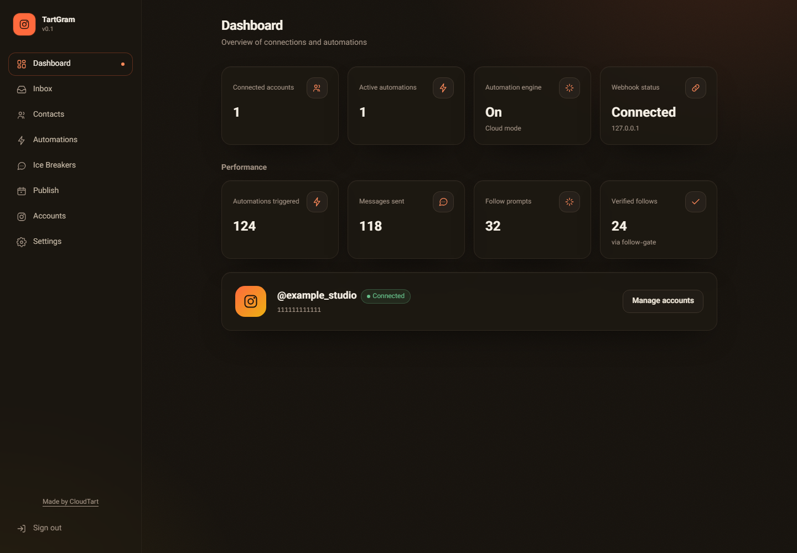
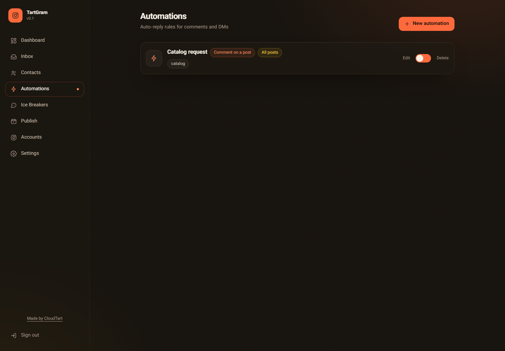
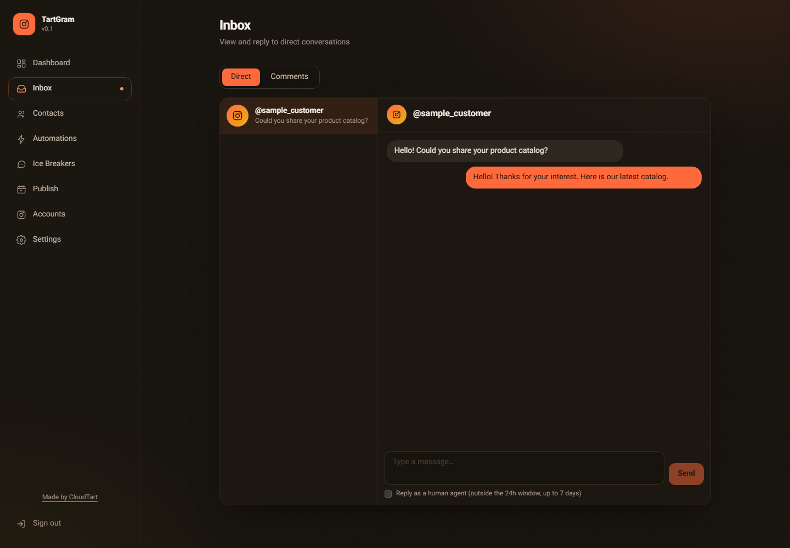
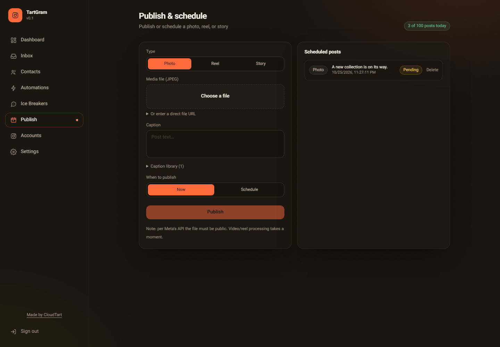
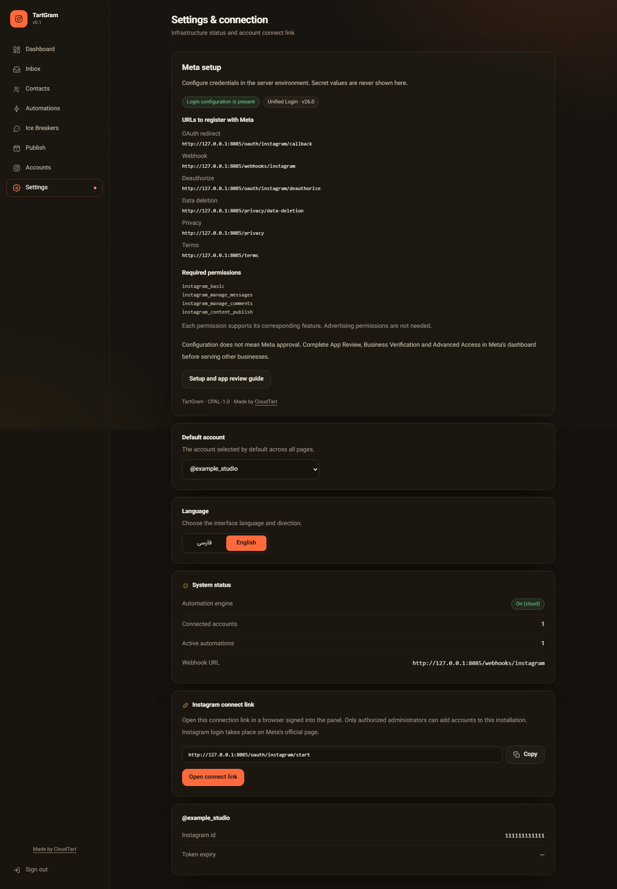

# TartGram

**Self-hosted Instagram automation, built by [CloudTart](https://cloudtart.com).**

[فارسی](docs/README.fa.md) · [Installation](docs/installation.md) · [Meta setup](docs/meta-setup.md) · [Operations](docs/operations.md) · [Screenshots](docs/screenshots/README.md)

TartGram gives you a web control panel and a server for Instagram professional accounts, using **only Meta's official APIs, OAuth and signed webhooks**. Run it on your own server with your own Meta app. No Instagram passwords, session cookies, scraping or private endpoints are collected by the application.

The source code is free under **CPAL-1.0**, with visible CloudTart attribution. You supply hosting, an HTTPS domain and the Meta app permissions needed for your use case. This repository does not include app approval or shared credentials, and is independent of Meta.



## What you can do

| Feature | Available in the web panel |
| --- | --- |
| Comment automation | Match keywords or all comments; target selected posts; send one private reply and an optional public reply |
| Direct messages | Keyword replies, default replies, story replies and story mentions |
| Follow gate | Check the official follow relationship after a user interacts; no automatic follows |
| Inbox | Read recent conversations and comments; reply, hide or delete comments |
| Ice breakers | Configure up to four conversation starters |
| Contacts | View contacts and export CSV; send operator-selected messages only within verified messaging windows |
| Publishing | Upload JPEG/MP4 media; publish images, reels or stories immediately or on a schedule |
| Settings | Account selection, callback URLs, setup guidance, Persian/English and RTL/LTR |

Each installation is one trusted administrative workspace. Everyone with its management token can manage all connected accounts. It is not a customer-isolated multi-tenant service.

## Install

The recommended deployment uses Docker Compose and Caddy for automatic HTTPS. Point a domain to your server and open ports 80/443 first.

```sh
git clone https://github.com/farshad-zamani/tartgram.git
cd tartgram
cp .env.example .env
```

Edit `PUBLIC_HOST`, `PUBLIC_URL`, `OPERATOR_NAME` and `OPERATOR_CONTACT_URL`. With Node.js 24 installed, initialize the three local secrets without printing them:

```sh
node scripts/generate-secrets.mjs --write
docker compose up --build -d
```

If Node is not installed on the host, use `docker run --rm --user "$(id -u):$(id -g)" -v "$PWD:/work" -w /work node:24-bookworm-slim node scripts/generate-secrets.mjs --write` instead. On Windows, use Node locally or follow the PowerShell instructions in the installation guide.

Open `https://YOUR_DOMAIN/app/` and enter your `GATEWAY_CLIENT_TOKEN` from your private `.env`. The panel uses an expiring cookie session and does not persist that token in browser storage. Finish the [Meta setup guide](docs/meta-setup.md), set the app credentials in `.env`, restart the gateway, then connect your Instagram account.

**New Meta apps use Unified Login.** Legacy Instagram Login remains available for eligible existing apps. Business verification, App Review, Advanced Access and Live mode are separate steps controlled by Meta. A running panel or successful mock test does not establish approval.

## Try the interface locally

```sh
pnpm install --frozen-lockfile
pnpm build
pnpm test:run
pnpm exec playwright install chromium
pnpm test:browser
```

Browser tests run an isolated loopback preview and use fictional API fixtures for the screenshots. No account connection or public demo server is required. [Direct installation and development instructions](docs/installation.md) explain how to run a local gateway with your own settings.

## Screenshots

These are captures of the real interface using **fictional sample data**, not evidence of live Meta authorization.

| Automations | Inbox |
| --- | --- |
|  |  |

| Publishing | Meta setup |
| --- | --- |
|  |  |

[Persian screenshots and mobile view](docs/screenshots/README.md)

## Status and boundaries

This is the first public release. Automated tests use official API response fixtures; **live end-to-end Meta testing and production app approval are not included in this release's validation**. See [validation and limitations](docs/validation.md).

The gateway runs as a single process with atomic JSON storage and encrypted account tokens. Horizontal scaling, a durable event queue, delayed flow continuations, full-history inbox synchronization and guaranteed exactly-once external publishing are not implemented. Publishing interrupted during shutdown is shown as uncertain and requires checking Instagram before retrying. Webhooks acknowledge promptly and process in the background; a process failure after acknowledgement can lose pending work.

**Desktop: coming soon.** If TartGram receives enough stars and community interest, we plan to prepare and release desktop packaging. No star threshold or delivery date is promised.

## Bugs, updates and contributions

Found a bug or a setup problem? [Open an issue](https://github.com/farshad-zamani/tartgram/issues) with reproduction steps, your version and sanitized logs. Reports will be investigated and fixes published in updates. Never post tokens, passwords, app secrets or customer data in an issue. Use [private security reporting](SECURITY.md) for vulnerabilities.

[Contributing](CONTRIBUTING.md) · [Changelog](CHANGELOG.md)

## License and attribution

[CPAL-1.0](LICENSE) permits use, modification and redistribution, including commercial use, subject to its terms. Preserve the visible **Made by CloudTart** attribution and the URL specified in Exhibit B. Source availability obligations also apply to external network deployment. See [NOTICE](NOTICE) and the full license.

Made by **[CloudTart](https://cloudtart.com)**.
