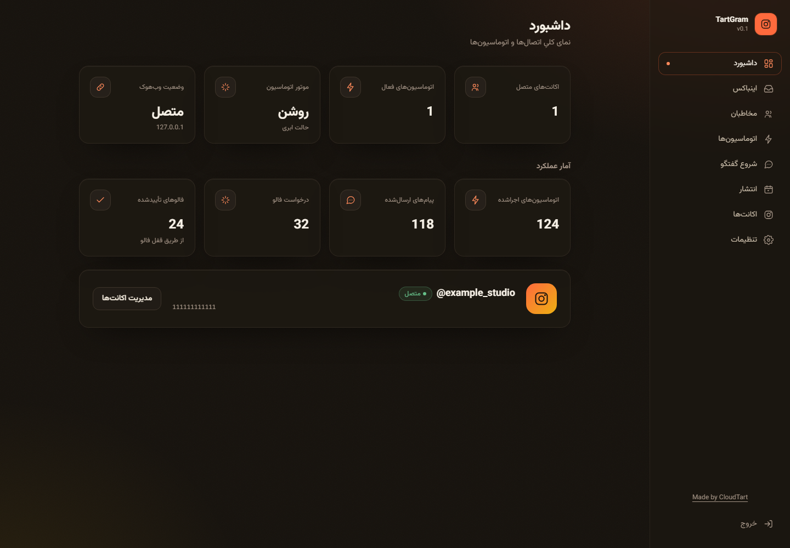

# TartGram — دستیار اینستاگرام کلادتارت

**پلتفرم رایگان قابل نصب روی سرور، ساختهٔ [CloudTart](https://cloudtart.com).**

[English](../README.md) · [راهنمای تخصصی اتصال متا](meta-setup.md) · [نصب](installation.md) · [نگه‌داری](operations.md) · [تصاویر](screenshots/README.md)

TartGram یک پنل وب و سرور برای مدیریت و اتوماسیون اکانت‌های حرفه‌ای اینستاگرام است. تمام اتصال‌ها از **APIهای رسمی متا، ورود OAuth و وب‌هوک امضاشده** استفاده می‌کنند. برنامه رمز اینستاگرام یا کوکی نشست حساب را دریافت نمی‌کند و از اسکرپینگ یا API خصوصی استفاده نمی‌کند.

سورس با مجوز **CPAL-1.0** رایگان است. برای اجرای آن باید سرور، دامنهٔ HTTPS و اپ متای خودتان را داشته باشید و تأییدیه‌های موردنیاز را دریافت کنید. این مخزن کلید مشترک یا اپ ازپیش‌تأییدشده ارائه نمی‌دهد. هزینهٔ زیرساخت بر عهدهٔ بهره‌بردار است.



## امکانات نسخهٔ وب

- پاسخ خصوصی به کامنت بر اساس کلمهٔ کلیدی یا تمام کامنت‌ها؛ انتخاب پست‌های هدف و پاسخ عمومی اختیاری.
- پاسخ به دایرکت با کلمات کلیدی، پاسخ پیش‌فرض، پاسخ استوری و منشن استوری.
- بررسی رابطهٔ فالو از API رسمی پس از تعامل کاربر؛ بدون فالو خودکار.
- صندوق دایرکت‌ها و کامنت‌های اخیر؛ پاسخ، مخفی‌کردن و حذف کامنت.
- تنظیم حداکثر چهار شروع‌کنندهٔ گفتگو یا Ice Breaker.
- فهرست مخاطبان، خروجی CSV و ارسال انتخاب‌شده توسط مدیر در پنجرهٔ مجاز پیام‌رسانی.
- آپلود JPEG و MP4؛ انتشار عکس، ریلز و استوری به‌صورت فوری یا زمان‌بندی‌شده.
- رابط فارسی و انگلیسی، پشتیبانی RTL/LTR و نمایش نشانی‌های موردنیاز متا در تنظیمات.

هر نصب یک فضای مدیریتی برای مدیران مورد اعتماد است. هرکس توکن مدیریت را داشته باشد به تمام حساب‌های آن نصب دسترسی دارد. این نسخه جداسازی مشتریان مستقل، سطح دسترسی کارکنان یا سرویس چندمستاجری ارائه نمی‌کند.

## نصب روی سرور با Docker

پیش‌نیازها: سرور لینوکس با Docker و Docker Compose، دیسک پایدار، دسترسی خروجی به متا، و دامنه‌ای که به سرور اشاره کند. پورت‌های TCP ۸۰ و ۴۴۳ باید برای Caddy آزاد باشند. برای ساخت کلیدها روی میزبان، Node.js 24 کافی است.

```sh
git clone https://github.com/farshad-zamani/tartgram.git
cd tartgram
cp .env.example .env
node scripts/generate-secrets.mjs --write
```

در PowerShell به‌جای دستور کپی از `Copy-Item .env.example .env` استفاده کنید. اگر Node روی میزبان نیست، دستور جایگزین Docker در [راهنمای نصب](installation.md) موجود است.

فایل خصوصی `.env` را ویرایش کنید:

| متغیر | مقدار موردنیاز |
| --- | --- |
| `PUBLIC_HOST` | دامنهٔ شما، بدون `https://` |
| `PUBLIC_URL` | همان دامنه با `https://`، بدون مسیر اضافی |
| `OPERATOR_NAME` | نام واقعی بهره‌بردار این نصب |
| `OPERATOR_CONTACT_URL` | نشانی HTTPS تماس با بهره‌بردار |
| `META_LOGIN_MODE` | برای اپ جدید `unified` |
| `META_GRAPH_VERSION` | پیش‌فرض `v26.0` |
| `META_APP_ID` | شناسهٔ اپ اصلی متا |
| `META_APP_SECRET` | سکرت اپ اصلی متا؛ برای تأیید امضای اعلان‌ها نیز استفاده می‌شود |
| `META_CONFIG_ID` | شناسهٔ configuration مربوط به Unified Login |
| `META_VERIFY_TOKEN` | مقدار تصادفی تولیدشده؛ همین مقدار را در تنظیم وب‌هوک متا وارد کنید |
| `GATEWAY_CLIENT_TOKEN` | توکن ورود مدیر به پنل؛ محرمانه نگه دارید |
| `TOKEN_ENCRYPTION_KEY` | کلید مستقل رمزنگاری توکن‌های ذخیره‌شده؛ آن را همراه بکاپ محفوظ نگه دارید |

اسکریپت تولید کلید فقط مقادیر خالی را پر می‌کند و آن‌ها را در ترمینال چاپ نمی‌کند. برای تعویض کلید رمزنگاری، صرفاً اجرای مجدد اسکریپت کافی نیست؛ کلید قدیمی برای خواندن اطلاعات قبلی لازم است. `.env` را هرگز در گیت‌هاب، پیام عمومی یا پوشهٔ قابل دریافت وب قرار ندهید.

سپس اجرا کنید:

```sh
docker compose up --build -d
docker compose ps
```

Caddy پس از صحیح‌بودن DNS و دسترسی پورت‌ها گواهی HTTPS دریافت می‌کند. پنل در `https://YOUR_DOMAIN/app/` است. با مقدار `GATEWAY_CLIENT_TOKEN` وارد شوید. مرورگر یک نشست محدودمدت دریافت می‌کند و توکن مدیریت را در حافظهٔ دائمی مرورگر نگه نمی‌دارد.

اطلاعات در volume با نام `tartgram-data` ذخیره می‌شوند. پورت gateway مستقیماً روی اینترنت منتشر نمی‌شود. چند پردازش یا چند کانتینر gateway را به یک پوشهٔ داده وصل نکنید.

## راه‌اندازی رسمی اپ متا

این راهنما بر اساس مستندات رسمی بررسی‌شده در **۲۴ اکتبر ۲۰۲۶** نوشته شده است. نام گزینه‌های داشبورد ممکن است تغییر کند؛ لینک‌های بخش منابع در [راهنمای متا](meta-setup.md) مرجع اصلی هستند.

### ساخت اپ و معرفی کسب‌وکار

۱. حساب توسعه‌دهندهٔ متا ایجاد و اپی با کاربرد **Manage messaging & content on Instagram** بسازید.

۲. اپ باید به **Business Portfolio** متعلق به کسب‌وکار شما متصل باشد. اگر تب Unified Login دیده نمی‌شود، ابتدا مالکیت و اتصال اپ به Business Portfolio را بررسی کنید.

۳. حساب اینستاگرام باید **Business یا Creator** باشد. اکانت شخصی باید ابتدا در خود اینستاگرام حرفه‌ای شود. برای تست از حساب واقعی و مجاز استفاده کنید؛ Test User مصنوعی متا در مسیر Unified پشتیبانی نمی‌شود.

۴. دامنه و نشانی‌های `/privacy`، `/terms`، callback ورود، لغو دسترسی و حذف داده را در تنظیمات اپ ثبت کنید. مقادیر دقیق در تنظیمات TartGram نمایش داده می‌شوند. نام و تماس بهره‌بردار و متن حریم خصوصی باید با میزبانی واقعی شما هماهنگ باشند.

### ساخت configuration برای Unified Login

مسیر فعلی داشبورد:

**Use cases → Manage messaging & content on Instagram → Customize → API setup with Unified login**

در **Configure your app** یک configuration بسازید یا موردی با برچسب **Instagram Login Compatible** انتخاب کنید. دارایی موردنیاز حساب اینستاگرام است. این چهار مجوز برای قابلیت‌های برنامه استفاده می‌شوند:

| مجوز | کاربرد |
| --- | --- |
| `instagram_basic` | شناسایی حساب و دریافت اطلاعات و رسانه‌های آن |
| `instagram_manage_messages` | دریافت و ارسال پیام، شروع گفتگو و اعلان‌های پیام‌رسانی |
| `instagram_manage_comments` | دریافت، پاسخ، مخفی‌کردن و حذف کامنت و اعلان‌های مربوط |
| `instagram_content_publish` | انتشار عکس، ریلز و استوری |

پیکربندی پیش‌فرض متا ممکن است مجوز تبلیغات داشته باشد. `ads_read` و `ads_management` را حذف کنید؛ این نسخه قابلیت تبلیغات ندارد. اگر انتخاب اکانت تبلیغاتی به‌صورت اختیاری باقی ماند، کاربر می‌تواند از آن عبور کند.

نشانی redirect را دقیقاً برابر مقدار پنل ثبت کنید؛ پیش‌فرض `https://YOUR_DOMAIN/oauth/instagram/callback` است. تفاوت مسیر، پروتکل یا اسلش انتهایی می‌تواند ورود را خراب کند. شناسهٔ configuration را در `META_CONFIG_ID` و اطلاعات اپ اصلی را در `META_APP_ID` و `META_APP_SECRET` بگذارید. اطلاعات اپ قدیمی اینستاگرام را با این موارد اشتباه نگیرید.

پس از تغییر `.env` کانتینر را بازسازی تنظیمات کنید:

```sh
docker compose up -d --force-recreate gateway
```

### تنظیم وب‌هوک

در بخش Configure webhooks یا شیء Instagram در داشبورد، Callback URL را برابر `https://YOUR_DOMAIN/webhooks/instagram` و Verify Token را برابر `META_VERIFY_TOKEN` قرار دهید. این مقدار با App Secret و Access Token متفاوت است.

فیلدهای مورد استفاده: `comments`، `live_comments`، `messages`، `message_reactions`، `messaging_postbacks`، `messaging_seen` و `messaging_referral`. دسترسی به هر فیلد و شرایط تست آن را در جدول رسمی متا بررسی کنید. ممکن است برخی اعلان‌ها پیش از Advanced Access کار نکنند؛ برای کامنت، حساب مالک رسانه باید عمومی باشد.

بعد از ورود موفق، خود TartGram هر حساب واگذارشده را نیز در `/subscribed_apps` مشترک می‌کند. انتخاب فیلدهای اپ به‌تنهایی کافی نیست. اگر این مرحله شکست بخورد، وضعیت حساب نیازمند توجه می‌شود و اتوماسیون تا اتصال مجدد موفق فعال نخواهد شد.

### تست حساب خودتان

از Generate access tokens، حساب حرفه‌ای خود را به‌عنوان Instagram Tester اضافه و دعوت را در نسخهٔ وب اینستاگرام، بخش Website permissions → Apps and websites → Tester Invites قبول کنید.

داخل پنل «اتصال اینستاگرام» را انتخاب کنید. ورود فقط در صفحهٔ رسمی متا انجام می‌شود. Business Portfolio، حساب‌های قابل مدیریت و مجوزها را انتخاب کنید. در صورت درخواست، **Allow access to messages** را فعال کنید. کسانی که با فیسبوک وارد می‌شوند ممکن است لازم باشد این گزینه را جداگانه در تنظیمات اینستاگرام فعال کنند.

پس از بازگشت، وضعیت اکانت‌ها را ببینید. با یک حساب آزمایشی مجاز دیگر پیام، کامنت و شروع گفتگو را امتحان کنید. برای انتشار از رسانهٔ متعلق به خودتان استفاده کنید؛ این آزمایش پیام یا پست واقعی ایجاد می‌کند. تصاویر مخزن و تست‌های شبیه‌سازی‌شده جای این مرحله را نمی‌گیرند.

### تأیید شرکت و دسترسی عمومی

**Business Verification** را با هویت قانونی واقعی سازمان و مدارک خواسته‌شده در داشبورد تکمیل کنید؛ ممکن است ثبت کسب‌وکار، نام و نشانی، دامنه یا راه تماس و بررسی‌های تکمیلی لازم باشد. این اطلاعات متعلق به بهره‌بردار است و توسط نرم‌افزار یا این مخزن تأمین نمی‌شود.

برای اتصال کسب‌وکارهای فاقد نقش در اپ، باید برای مجوزهای استفاده‌شده **Advanced Access** بگیرید، **App Review** را بگذرانید و در زمان مجاز اپ را **Live** کنید. برای بازبینی آماده کنید:

- پنل قابل دسترس از اینترنت، دکمهٔ ورود رسمی و توضیح روشن دلیل درخواست هر مجوز.
- دستورالعمل دقیق ورود و آزمایش برای بازبین، دسترسی موقت خصوصی و داده‌های تست. توکن پنل دسترسی مدیریتی می‌دهد؛ از نصب مخصوص بررسی با حساب‌های آزمایشی استفاده کنید.
- ویدئو از جریان واقعی هر مجوز: اتصال حساب و دریافت اطلاعات، دریافت و پاسخ پیام، کامنت و پاسخ خصوصی، و انتشار رسانهٔ مجاز.
- صفحات صحیح حریم خصوصی و شرایط، callback حذف دادهٔ آزمایش‌شده، راه تماس و فرم‌های مربوط به پردازش اطلاعات.
- بررسی‌های دوره‌ای یا الزامات Tech Provider و Data Use Checkup که داشبورد برای کاربرد شما نمایش می‌دهد.

وجود تنظیمات در پنل، تأیید متا محسوب نمی‌شود. این پروژه راه دورزدن تأیید شرکت یا مجوزهای متا ارائه نمی‌کند.

## توکن‌ها و روش قدیمی اتصال

توکن Unified به Business Portfolio و دارایی‌های واگذارشده مرتبط است. انقضای آن به configuration بستگی دارد و برنامه مقدار واقعی گزارش‌شدهٔ متا را ثبت می‌کند. با انقضا، لغو مجوز یا انتقال دارایی ممکن است اتصال مجدد لازم باشد. این نسخه مجوز `business_management` یا مدیریت خودکار اختیاری توکن‌های System User را پیاده نکرده است.

برای اپ قدیمی واجد شرایط، `META_LOGIN_MODE=instagram` و اطلاعات جداگانهٔ `INSTAGRAM_APP_ID` و `INSTAGRAM_APP_SECRET` را تنظیم کنید؛ سکرت اپ اصلی نیز برای اعلان‌های امضاشده لازم است. مجوزهای این مسیر از خانوادهٔ `instagram_business_*` هستند. توکن‌های بلندمدت واجد شرایط در نزدیکی انقضا با endpoint رسمی تمدید می‌شوند؛ توکن منقضی به اتصال مجدد نیاز دارد.

طبق راهنمای فعلی متا، ساخت اپ تازه با مسیر قدیمی ممکن نیست، ولی برای اتصال‌های قبلی تاریخ توقف اعلام نشده است. تغییر متغیر حالت، توکن‌ها و شناسه‌ها را تبدیل نمی‌کند. برای مهاجرت، نصب جداگانه بسازید، حساب‌ها را دوباره متصل کنید و نگاشت شناسه‌ها و اتوماسیون‌ها را پس از آزمایش صریح انجام دهید. هم‌زمان یک اتوماسیون را در دو نصب فعال نگه ندارید.

## محدودیت‌های پیام و انتشار

پاسخ مستقیم معمول به تعامل ورودی تأییدشده در پنجرهٔ ۲۴ساعته نیاز دارد. پاسخ خصوصی کامنت یک پیام در هفت روز است؛ پیام بعدی به پاسخ خود مخاطب نیاز دارد. پاسخ خصوصی کامنت لایو فقط هنگام پخش مجاز است. تگ Human Agent مخصوص پشتیبانی دستی، نیازمند تأیید متا و در حالت پیش‌فرض خاموش است؛ برای اتوماسیون و ارسال گروهی استفاده نمی‌شود.

حجم متن پیام بر اساس بایت UTF-8 بررسی می‌شود؛ ۱۰۰۰ بایت الزاماً ۱۰۰۰ حرف فارسی نیست. سهمیهٔ انتشار از API حساب خوانده می‌شود و در صورت خطا عدد فرضی نمایش داده نمی‌شود. آپلود تا ۲۰۰ مگابایت پذیرفته می‌شود، ولی مشخصات واقعی رسانه باید با محدودیت‌های متا هم مطابقت داشته باشد.

زمان‌بندی با زمان محلی مرورگر وارد و به زمان استاندارد ذخیره می‌شود؛ ساعت سرور و منطقهٔ زمانی مرورگر را بررسی کنید. اگر انتشار وسط راه قطع شود، وضعیت نامطمئن نمایش داده می‌شود و نباید بدون بررسی خود اینستاگرام آن را تکرار کرد.

فایل آپلودشده نشانی عمومی غیرقابل حدس دارد تا متا بتواند آن را دریافت کند؛ دادهٔ محرمانه آپلود نکنید. فایل‌های بلااستفاده پس از هفت روز در پاک‌سازی ساعتی حذف می‌شوند و فایل‌های لازم برای پست‌های در انتظار باقی می‌مانند.

## بکاپ، حذف داده و به‌روزرسانی

برای بکاپ سازگار، gateway را متوقف و **volume داده و فایل خصوصی `.env` را با هم** ذخیره کنید. بکاپ را خارج از مخزن و مسیر وب، با دسترسی محدود و ترجیحاً رمزنگاری‌شده نگه دارید. هش آن را بررسی و بازیابی را دوره‌ای روی نصب جداگانه و بدون ارسال درخواست به متا امتحان کنید. کلید رمزنگاری متناظر برای خواندن توکن‌ها لازم است.

در بازیابی، ابتدا سرور را متوقف کنید، داده را در volume خالی با مالکیت کاربر سرویس برگردانید و فایل تنظیمات متناظر را قرار دهید. قبل از شروع، پست‌های در انتظار و درخواست‌های حذف دادهٔ پس از تاریخ بکاپ را بررسی کنید. بازیابی نباید اطلاعات کاربرانی را که حذف خواسته‌اند دوباره فعال کند.

«قطع اتصال و حذف داده» در بخش اکانت‌ها توکن، مخاطبان، کامنت‌ها، اتوماسیون‌ها، آمار مربوط، پست‌های زمان‌بندی‌شده و آپلودهای همان حساب را پاک می‌کند. پیام‌ها یا پست‌هایی که قبلاً در اینستاگرام منتشر شده‌اند با حذف محلی پاک نمی‌شوند. نگه‌داری و حذف بکاپ‌ها و لاگ‌های زیرساخت مسئولیت بهره‌بردار است.

برای به‌روزرسانی، changelog را بخوانید، بکاپ معتبر بگیرید، نسخهٔ موردنظر را دریافت و `docker compose build gateway` و سپس `docker compose up -d gateway` را اجرا کنید. دوباره وارد شوید و با حساب مجاز تست کنید. تعویض تصادفی کلید رمزنگاری باعث از دست رفتن امکان خواندن توکن‌های قبلی می‌شود.

## نصب مستقیم و توسعه

با Node 24 و pnpm 11.13.1 از ریشهٔ پروژه اجرا کنید:

```sh
pnpm install --frozen-lockfile
pnpm build
pnpm start
```

`pnpm start` فایل `.env` را صریح می‌خواند. در نصب مستقیم، پردازش را با کاربر غیرریشه و پشت reverse proxy دارای HTTPS اجرا کنید و پوشهٔ داده را از مسیر عمومی وب جدا نگه دارید.

برای توسعهٔ محلی، `PUBLIC_URL=http://localhost:8080` و `ALLOW_INSECURE_LOCALHOST=true` را تنظیم کنید. این استثنا فقط برای loopback است؛ callback واقعی متا به HTTPS عمومی نیاز دارد. دستور `pnpm dev:gateway` سرور توسعه را اجرا می‌کند. مسیر `apps/desktop` فعلاً سورس پنل وب است؛ نام پوشه به معنی وجود نصب‌کنندهٔ دسکتاپ نیست.

## عیب‌یابی و گزارش مشکل

| مشکل | بررسی |
| --- | --- |
| سرور شروع نمی‌شود | تنظیمات لازم، مجوز پوشهٔ داده و کلید رمزنگاری متناظر |
| ورود ۴۰۳ می‌دهد | دامنه، پروتکل و پورت باید با `PUBLIC_URL` یکی باشند |
| ورود ۴۲۹ می‌دهد | یک دقیقه برای پایان محدودیت تلاش ورود صبر کنید |
| ورود متا منقضی شد | در همان مرورگر دوباره وارد پنل شوید و اتصال را از ابتدا انجام دهید |
| حساب دیده نمی‌شود | نوع Professional، Business Portfolio صحیح و واگذاری دارایی |
| پیام یا کامنت دریافت نمی‌شود | مجوزها، Allow access to messages، اشتراک حساب و فیلدهای اپ، حالت Live و دسترسی لازم |
| انتشار شکست می‌خورد | انقضا و مجوز توکن، سهمیه، مشخصات رسانه و وضعیت پردازش container |
| فایل داده خراب یا کلید اشتباه است | سرور را متوقف و بکاپ معتبر متناظر را بازیابی کنید؛ فایل را با آرایهٔ خالی جایگزین نکنید |

اگر باگ یا مشکلی دیدید، در [Issues](https://github.com/farshad-zamani/tartgram/issues) گزارش کنید تا بررسی و اصلاحات در به‌روزرسانی‌ها منتشر شود. نسخه، مراحل بازتولید، روش ورود و لاگ پاک‌سازی‌شده را بنویسید. رمز، توکن، کد OAuth، App Secret و پیام‌های خصوصی مشتریان را ارسال نکنید. آسیب‌پذیری امنیتی را از مسیر خصوصی [SECURITY.md](../SECURITY.md) گزارش کنید.

## وضعیت پروژه و مجوز

تست‌های نرم‌افزار با پاسخ‌های شبیه‌سازی‌شده و مرورگر واقعی اجرا می‌شوند. **این انتشار شامل تأیید اپ متا یا گواهی موفقیت تست زندهٔ سرتاسری نیست.** محدودیت‌های فنی و نتیجهٔ اعتبارسنجی در [این سند](validation.md) آمده است. صف پایدار وب‌هوک، اجرای چند پردازش، آرشیو کامل اینباکس و تأخیر پایدار در فلوها در این نسخه ارائه نشده‌اند.

**دسکتاپ: به‌زودی، در صورت استقبال و دریافت استار کافی.** با حمایت جامعه، آماده‌سازی و انتشار بستهٔ دسکتاپ در نقشهٔ راه قرار دارد؛ تاریخ یا تعداد استار قطعی وعده داده نمی‌شود.

مجوز **CPAL-1.0** استفاده، تغییر و توزیع از جمله استفادهٔ تجاری را طبق شرایط خود مجاز می‌کند. انتساب قابل‌مشاهدهٔ **Made by CloudTart** و لینک سازنده باید مطابق Exhibit B حفظ شود؛ ارائهٔ شبکه‌ای نیز تعهدات انتشار سورس دارد. متن کامل [LICENSE](../LICENSE) ملاک است.

ساختهٔ **[کلادتارت — CloudTart](https://cloudtart.com)**.
